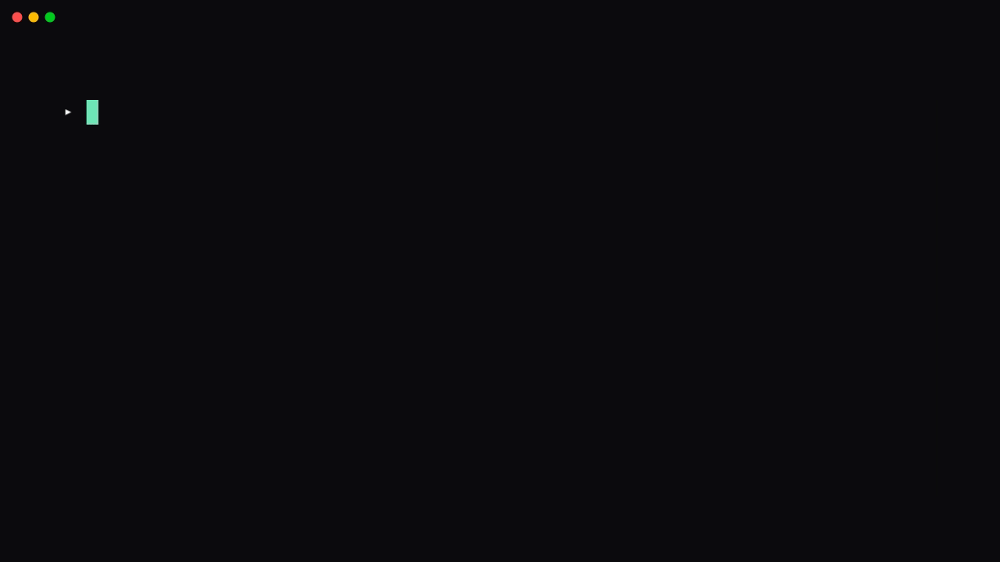

<script
  type="application/ld+json"
  dangerouslySetInnerHTML={{
    __html: JSON.stringify({
      "@context": "https://schema.org",
      "@type": "TechArticle",
      "@id": "https://rendobar.com/docs/cli#article",
      "headline": "Run FFmpeg from your terminal",
      "description": "Install the rb binary, sign in, and run any ffmpeg command in the cloud from your shell. Local files upload and download for you.",
      "datePublished": "2026-06-22",
      "author": { "@type": "Organization", "@id": "https://rendobar.com/#organization" },
      "publisher": { "@type": "Organization", "@id": "https://rendobar.com/#organization" }
    })
  }}
/>

`rb` runs FFmpeg in the cloud from your shell. Write the same `ffmpeg` command you'd run locally, prefix it with `rb`, and it uploads your inputs, runs the job, and downloads the result.

<Frame>
  
</Frame>

```bash
curl -fsSL https://rendobar.com/install.sh | sh
rb login
rb ffmpeg -i clip.mp4 -vf scale=1280:720 -c:v libx264 -crf 23 out.mp4
```

That's the whole loop. `rb login` opens your browser for OAuth. The render command uploads `clip.mp4`, runs an [`ffmpeg`](/jobs/ffmpeg) job, and writes the output to `out.mp4`. Progress goes to stderr, so stdout stays clean for piping.

The CLI also runs [`ffprobe`](/jobs/ffprobe), [image generation](/jobs/image-generate), and [image editing](/jobs/image-edit) jobs, browses your connected storage, and prints the AI integration prompt. For any other job type, or for a Node or TypeScript program, use the [SDK](https://www.npmjs.com/package/@rendobar/sdk).

## Install

<Tabs>
  <Tab title="macOS / Linux">
    ```bash
    curl -fsSL https://rendobar.com/install.sh | sh
    ```
  </Tab>
  <Tab title="Windows">
    ```powershell
    irm https://rendobar.com/install.ps1 | iex
    ```
  </Tab>
</Tabs>

The installer pulls the matching release from [github.com/rendobar/cli/releases](https://github.com/rendobar/cli/releases), checks a SHA-256, drops `rb` at `~/.rendobar/bin/rb` (or `%USERPROFILE%\.rendobar\bin\rb.exe`), and adds it to your PATH. Open a new shell, then verify:

```bash
rb --version
rb doctor
```

The installer takes the latest stable release. To pin a version for a Dockerfile or provisioning script, set `RENDOBAR_VERSION` to a tag from the [releases page](https://github.com/rendobar/cli/releases). Set it on `sh`, the side of the pipe that runs the installer:

```bash
curl -fsSL https://rendobar.com/install.sh | RENDOBAR_VERSION=v1.14.0 sh
```

`rb update` self-replaces the binary in place (SHA-256 verified, rolls back on failure). To remove `rb`, run `curl -fsSL https://rendobar.com/uninstall.sh | sh` (or the `.ps1` on Windows).

## Authenticate

The CLI reads the `RENDOBAR_API_KEY` env var first, then the credential file `rb login` writes. That file holds one credential, the OAuth token or the `--key` API key, whichever you saved last.

```bash
rb login                 # browser OAuth, saves a refreshing token
rb login --key rb_xxx    # paste a key for headless or SSH sessions
rb whoami                # print org, plan, balance
rb logout                # revoke the token and delete the credential file
```

`rb login` runs an OAuth 2.1 PKCE flow on `http://127.0.0.1:14832/callback`. Access tokens expire after 1 hour and refresh automatically, so you won't see a re-login prompt unless the token is revoked. Credentials live at `~/.config/rendobar/credentials.json` (`%APPDATA%\rendobar\credentials.json` on Windows). Treat that file as a secret.

Get an API key from [app.rendobar.com](https://app.rendobar.com) under Settings, API keys. Keys start with `rb_`.

## Commands

| Command | What it does |
|---|---|
| `rb ffmpeg <args>` | Run FFmpeg in the cloud. Pass real `ffmpeg` flags. Local `-i` inputs upload automatically |
| `rb ffprobe <args> <url-or-file>` | Run an ffprobe command in the cloud and print the result to stdout. A local file uploads first |
| `rb generate --prompt <text>` | Generate an image from a text prompt and print its URL |
| `rb edit --prompt <text> --image <url-or-path>` | Edit one or more images from a text instruction and print the result URL |
| `rb storage list` | List the buckets connected on the [Storage page](https://app.rendobar.com/storage). `--json` prints JSON |
| `rb storage ls <id>[/folder]` | List folders and files in a connected bucket, each with its `storage://` URI. `--all` reads every page, `--json` prints JSON |
| `rb prompt [--copy]` | Print the AI integration prompt to paste into Claude, ChatGPT, or Cursor. `--copy` also puts it on the clipboard |
| `rb login [--key <key>]` | Sign in via browser OAuth, or save an API key with `--key` |
| `rb logout` | Revoke the token and delete the credential file |
| `rb whoami` | Print the current org, plan, and balance |
| `rb doctor [--fix] [--json]` | Run install and connectivity checks. `--fix` clears the macOS quarantine bit |
| `rb update` | Update `rb` to the latest release |
| `rb telemetry [action]` | Control anonymous usage telemetry. The action is `on`, `off`, or `status` (the default). `DO_NOT_TRACK=1` or `RENDOBAR_TELEMETRY=0` also turns it off, and CI runs never send it |

### rb ffmpeg flags

These flags belong to `rb ffmpeg`. Everything else after the subcommand passes through to FFmpeg verbatim.

| Flag | Effect |
|---|---|
| `--output <path>` | Write the output to this local path instead of the output filename in the command |
| `--output-dir <dir>` | Write a multi-file output, such as an HLS or DASH stream, into this local folder |
| `--no-download` | Submit and report, but don't download |
| `--json` | Print the full job result as JSON to stdout |
| `--url-only` | Print only the signed result URL to stdout. Nothing downloads |
| `--quiet` | Print nothing. Read the exit code |
| `--no-wait` | Submit and exit, printing the job ID |
| `--timeout N` | Max execution time in seconds. The CLI sends 120 unless you set it, and caps the value at 900. A value that isn't a positive whole number falls back to 120 |
| `--compute <mode>` | `auto`, `cpu`, or `gpu`. Omit it and the job uses `auto`. GPU jobs need a Pro or Studio plan. See [GPU acceleration](/jobs/ffmpeg#can-i-use-gpu-acceleration) |
| `--deliver <uri>` | Also write the output to connected storage, for example `storage://prod-media/exports`. Repeat for more buckets. Also on `rb generate` and `rb edit` |

Local inputs (`-i ./clip.mp4`) upload before submission and are rewritten to short-lived URLs. Remote inputs (`-i https://...`) pass through untouched. The trailing output filename is where the result downloads to. A multi-file output downloads into a folder named after it.

`rb ffprobe` takes `--json` (the full probe data instead of the summary), `--quiet`, `--no-wait`, and `--timeout N`. Its timeout defaults to 60 seconds, with the same 900 cap.

### rb generate and rb edit flags

Both commands print the image URL to stdout and download nothing unless you pass `--output`.

| Flag | Effect |
|---|---|
| `--prompt <text>` | The prompt for `rb generate`, or the edit instruction for `rb edit`. Required |
| `--image <url-or-path>` | `rb edit` only. The image to edit. Repeat for up to 4 images. Some models take fewer. Local paths upload first. Required |
| `--model <id-or-tier>` | A model id or a tier: `economy`, `standard`, or `premium`. Omit it and the job uses `economy` |
| `--seed <n>` | Seed for reproducible output |
| `--width <n>`, `--height <n>` | `rb generate` only. Output size in pixels |
| `--enhance` | `rb generate` only. Let the model expand your prompt |
| `--negative <text>` | `rb generate` only. What the image should avoid |
| `--guidance <n>` | `rb generate` only. Guidance (CFG) scale |
| `--steps <n>` | `rb generate` only. Diffusion steps |
| `--output <path>` | Also download the image to this local path |
| `--json`, `--url-only`, `--quiet`, `--no-wait`, `--deliver <uri>` | Same as on `rb ffmpeg` |

```bash
rb generate --prompt "a red fox in a snowy forest" --output fox.webp
rb edit --prompt "make the sky purple" --image ./photo.jpg --output edited.webp
```

A delivery starts after the job completes. rb waits up to five minutes for it and prints where each one landed.

`rb storage` needs storage access. If you signed in before rb asked for it, run `rb login` again, or use an API key made on or after September 13, 2026.

### Exit codes

| Code | Meaning |
|---|---|
| `0` | Success |
| `1` | Job failed, a delivery did not land, or a generic runtime error |
| `2` | Not authenticated, bad arguments, port in use, insufficient credits, or a credential without storage access |
| `130` | Cancelled with `Ctrl+C`. The CLI tries to cancel the in-flight job first |

## How do I run it in CI?

`RENDOBAR_API_KEY` is the only auth path for CI. It beats any saved credential and writes nothing to disk. Don't run `rb login` in a pipeline, the browser flow will hang.

```yaml title=".github/workflows/render.yml"
jobs:
  render:
    runs-on: ubuntu-latest
    steps:
      - uses: actions/checkout@v4
      - name: Install Rendobar CLI
        run: |
          curl -fsSL https://rendobar.com/install.sh | sh
          echo "$HOME/.rendobar/bin" >> "$GITHUB_PATH"
        env:
          RENDOBAR_VERSION: v1.14.0
      - name: Render
        run: rb ffmpeg -i ./input.mp4 -c:v libx264 -crf 23 out.mp4
        env:
          RENDOBAR_API_KEY: ${{ secrets.RENDOBAR_API_KEY }}
      - uses: actions/upload-artifact@v4
        with:
          name: rendered
          path: out.mp4
```

`install.sh` updates PATH via shell rc files that later steps don't read, so the `echo … >> "$GITHUB_PATH"` line carries the install dir forward. The same pattern works in GitLab CI or Docker: install with `RENDOBAR_NO_MODIFY_PATH=1`, pass the key as a masked secret, and parse output with `--json` or `--url-only`.

```bash
URL=$(rb ffmpeg --url-only -i in.mp4 -c:v libx264 out.mp4)
rb ffmpeg --json -i in.mp4 -c:v libx264 out.mp4 | jq -r '.id'
```

The CLI has no `--idempotency-key`. If a retried step must not double-charge, submit via the [SDK](https://www.npmjs.com/package/@rendobar/sdk) or [`POST /jobs`](/jobs/ffmpeg) with an `idempotencyKey` field.

## What do I do when a command fails?

`rb doctor` runs the install and connectivity checks and prints a `fix:` line under any failure. Run it first. The three you'll actually hit:

<AccordionGroup>
  <Accordion title="rb: command not found after install">
    The shell hasn't reloaded. Open a new terminal, or `source ~/.zshrc` / `~/.bashrc`. If you set `RENDOBAR_NO_MODIFY_PATH=1` or a custom `RENDOBAR_INSTALL_DIR`, add it yourself: `export PATH="$HOME/.rendobar/bin:$PATH"`.
  </Accordion>
  <Accordion title="curl 403 or 429 during install">
    GitHub Releases rate-limits at 60/hr per IP when unauthenticated. Pass a token to the installer: `curl -fsSL https://rendobar.com/install.sh | RENDOBAR_GITHUB_TOKEN=ghp_xxx sh`. The installer also reads `GITHUB_TOKEN`, so in GitHub Actions you can set `GITHUB_TOKEN: ${{ secrets.GITHUB_TOKEN }}` in the install step's `env`.
  </Accordion>
  <Accordion title="Login fails or port 14832 is in use">
    Another process holds the OAuth callback port, or your network blocks loopback HTTP. Skip the browser entirely: `rb login --key rb_xxx`. A `Refresh failed: invalid_grant` means the token was revoked, so run `rb logout && rb login`.
  </Accordion>
</AccordionGroup>

For anything else, run `rb doctor --json` and file a bug at [github.com/rendobar/cli/issues](https://github.com/rendobar/cli/issues).

## See also

- [FFmpeg job reference](/jobs/ffmpeg): the API the CLI calls per run
- [API authentication](/quickstart): keys and OAuth across REST and MCP
- [SDK](https://www.npmjs.com/package/@rendobar/sdk): every job type, typed, for Node and TypeScript
- [Changelog](https://rendobar.com/changelog/): version history and release notes
