A timeline holds tracks, and each track holds clips.

- **Tracks stack.** The first track is the background. Each later track draws on top of the ones below it, for overlays, titles and picture-in-picture.
- **Clips sit in time.** A clip can have a `start` and a `length` in seconds, or leave both out. A transition joins two clips on the same track. A gap between clips plays nothing.

## Timing is optional

Every clip sits in a container, which is its scene or the whole video.

- Omit `length` and the clip runs as long as its content, but never past its container.
- Write `length: "end"` and it runs to the end of its container, however long its content is.

Content length is the source duration, the trim span, the source duration divided by `speed`, or a composition's own end. For example, `speed: 0.5` on a 4 second clip lasts 8 seconds.

Text and images have no duration of their own, so both rules give the same result. A title with no `length` stays up for the whole video, which suits a watermark.

`start` works the same way. Omit it and the clip begins after the clips already on its track, moved earlier by any transition right before it. Set a number and the clip starts that many seconds into its container.

Set either field when you want different timing. Timelines that set every `start` and `length` render as they always did.

## Worked examples

A music bed. The source is three minutes long and the video is shorter. `"end"` stops the music with the video, without you adding up the clips above it.

```json
"tracks": [
  { "clips": [
    { "asset": { "type": "video", "src": "https://cdn.rendobar.com/assets/examples/river.mp4" } },
    { "asset": { "type": "video", "src": "https://cdn.rendobar.com/assets/examples/forest.mp4" } }
  ] },
  { "clips": [
    { "asset": { "type": "audio", "src": "https://cdn.rendobar.com/assets/showcase/music.mp3", "volume": 0.35, "fadeOut": 2 },
      "length": "end" }
  ] }
]
```

A watermark needs no timing fields at all.

```json
{ "clips": [
  { "asset": { "type": "image", "src": "https://cdn.rendobar.com/assets/brand/logo-mark.png" },
    "transform": { "scale": 0.15, "position": { "x": "88%", "y": "12%" } }, "opacity": 0.8 }
] }
```

Both stop on the last frame, however long the other clips run. If you add another clip later, they still do.

The music bed as a chart. On track 1 the two clips play in turn because neither sets a `start`. The music has `length: "end"`, so it stops on the last frame.

```mermaid
gantt
    title Two clips and a music bed, in seconds
    dateFormat X
    axisFormat %S
    section Track 2, music
    audio, length "end" : 0, 12
    section Track 1, video
    river.mp4            : 0, 6
    forest.mp4           : 6, 12
```



## The rules that fall out of it

A clip that runs to the end of the video is measured against every clip that does not, so two of them on different tracks both stop on the real last frame. Nothing may follow it on the same track. A timeline where no clip has a length of its own has no end to measure, and the API rejects it.

If two clips on one track overlap with no transition between them, they dissolve into each other across the overlap, as if a `crossfade` sat there. For a cut, start the second clip where the first ends.

A clip never runs past its container. A 6 second video in a 3 second scene plays 3 seconds, and a 2 second video in a 5 second scene plays 2. This holds whether you wrote the length or left it out.

`"end"` does not cap. It asks for the full length of the container, however long the source is. If the source is shorter, the job is rejected for outrunning its source. Leave `length` off, or trim less.

Inside a `composition`, `start` and `length` are both required. The clip that holds the composition sets its length, so there is nothing to append to and no container to measure against.

## Add a layer

A second track renders over the first. This example puts an animated title over the video.

```json
"tracks": [
  { "clips": [
    { "asset": { "type": "video", "src": "https://cdn.rendobar.com/assets/examples/sea.mp4" }, "start": 0, "length": 3 }
  ] },
  { "clips": [
    { "asset": { "type": "text", "text": "Coastal Escape", "style": { "font": "Inter", "size": 84, "color": "#FFFFFF" } },
      "start": 0, "length": 3 }
  ] }
]
```

## Background

`background` is the colour that shows wherever no clip draws, such as the bars around a boxed shot. The default is black. `"transparent"` makes those areas see-through on png and webm output. See [transparent video](/docs/jobs/compose/output#transparent-video).

```json
"timeline": {
  "background": "#059669",
  "tracks": [{ "clips": [{ "asset": { "type": "video", "src": "https://cdn.rendobar.com/assets/examples/sea.mp4" }, "transform": { "size": { "width": "46%", "height": "100%" } } }] }]
}
```

<Columns cols={2}>
  <Frame caption="before">
    <video src="https://cdn.rendobar.com/compose/showcase/background/before.mp4" poster="https://cdn.rendobar.com/compose/showcase/background/before.jpg" autoPlay loop muted playsInline controls />
  </Frame>
  <Frame caption="background #059669">
    <video src="https://cdn.rendobar.com/compose/showcase/background/after.mp4" poster="https://cdn.rendobar.com/compose/showcase/background/after.jpg" autoPlay loop muted playsInline controls />
  </Frame>
</Columns>

## Scene-first authoring

Tracks give you precise multi-track control. For an edit that plays one segment after another, you can write a list of scenes. Each scene is a segment with its own clips. A scene's `transition` blends into it from the previous scene, so put it on the second of two scenes. `overlays` is a flat list of clips that sit over the whole video, such as a logo or watermark.

```json
{
  "scenes": [
    { "duration": 4,
      "clips": [{ "asset": { "type": "video", "src": "https://cdn.rendobar.com/assets/examples/river.mp4" } }] },
    { "duration": 4, "transition": { "transition": "crossfade", "duration": 0.6 },
      "clips": [{ "asset": { "type": "video", "src": "https://cdn.rendobar.com/assets/examples/forest.mp4" } }] }
  ],
  "overlays": [
    { "asset": { "type": "image", "src": "https://cdn.rendobar.com/assets/brand/logo-mark.png" },
      "transform": { "scale": 0.2, "position": { "x": "88%", "y": "12%" } } }
  ]
}
```

A scene's clips can omit `start` and `length` to fill the whole scene. A scene can omit `duration` to take the length of the video inside it. Clip fields work the same as with tracks, except that animated text and 3D turns work only on top-level tracks and in `overlays`, not inside a scene or a composition. A timeline uses `scenes` or `tracks`, never both.

<Frame caption="two scenes, crossfaded">
  <video src="https://cdn.rendobar.com/compose/showcase/scenes/after.mp4" poster="https://cdn.rendobar.com/compose/showcase/scenes/after.jpg" autoPlay loop muted playsInline controls />
</Frame>

<Columns cols={2}>
  <Frame caption="before">
    <video src="https://cdn.rendobar.com/compose/showcase/overlays/before.mp4" poster="https://cdn.rendobar.com/compose/showcase/overlays/before.jpg" autoPlay loop muted playsInline controls />
  </Frame>
  <Frame caption="a logo over both scenes">
    <video src="https://cdn.rendobar.com/compose/showcase/overlays/after.mp4" poster="https://cdn.rendobar.com/compose/showcase/overlays/after.jpg" autoPlay loop muted playsInline controls />
  </Frame>
</Columns>

## A timeline as one clip

A `composition` asset holds a timeline of its own, so you can move, scale and fade a group of layers together. Its `timeline` takes `tracks` only, and every clip inside needs an explicit `start` and `length`. Compositions nest up to three levels deep.

```json
{
  "asset": {
    "type": "composition",
    "timeline": {
      "tracks": [
        { "clips": [{ "asset": { "type": "video", "src": "https://cdn.rendobar.com/assets/examples/sea.mp4" }, "start": 0, "length": 6 }] },
        { "clips": [{ "asset": { "type": "text", "text": "OPEN WATER", "style": { "font": "Bebas Neue", "size": 84, "color": "#FFFFFF" } }, "start": 0, "length": 6 }] }
      ]
    }
  },
  "transform": { "scale": 0.52, "rotate": -5 },
  "start": 0,
  "length": 6
}
```

<Columns cols={2}>
  <Frame caption="before">
    <video src="https://cdn.rendobar.com/compose/showcase/composition/before.mp4" poster="https://cdn.rendobar.com/compose/showcase/composition/before.jpg" autoPlay loop muted playsInline controls />
  </Frame>
  <Frame caption="scaled and tilted as one clip">
    <video src="https://cdn.rendobar.com/compose/showcase/composition/after.mp4" poster="https://cdn.rendobar.com/compose/showcase/composition/after.jpg" autoPlay loop muted playsInline controls />
  </Frame>
</Columns>

## Where to go next

See [Transitions](/docs/jobs/compose/transitions) to blend clips together and [Keyframes and easing](/docs/jobs/compose/motion) to make things move. [Media clips](/docs/jobs/compose/media) covers what a clip can hold, and the [clip reference](/docs/jobs/compose/reference/timeline) lists every field.
